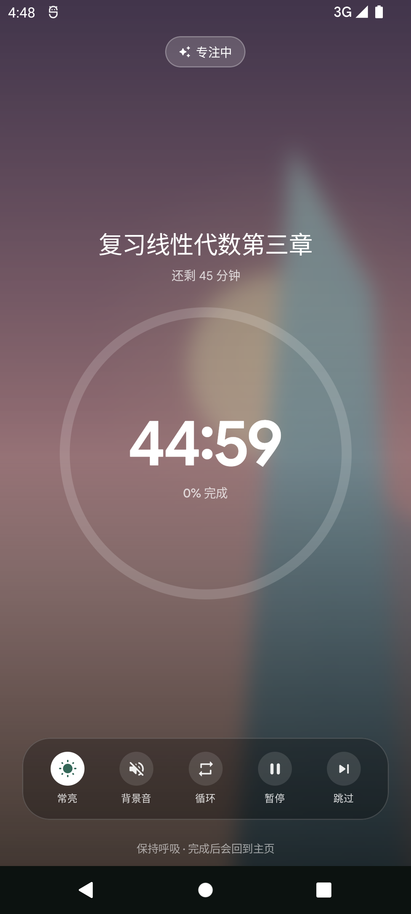

# TokiToDo

一个安静的自控工具：**待办 · 待办集 · 锁机 · 统计 · 我的**。

> 仓库：<https://github.com/ichiyotsu/TokiTodo>
> 下载：<https://github.com/ichiyotsu/TokiTodo/releases/latest>（Android 12+）

界面参考番茄 ToDo 的功能页，工程骨架与设计语言沿用 [TokiNote](https://github.com/ichiyotsu/TokiNote)，
视觉按 **Material Design 3 Expressive** 重做：大圆角、非对称卡片、弹簧动效、柔和纸色与 Canvas 插画。
数据只保存在本机，**不申请网络权限**。

| 待办 | 我的 | 计时页 |
| --- | --- | --- |
|  |  |  |

更多截图：[`screenshots/`](screenshots)（锁机、统计、编辑器、历史、海报、深色）。

---

## 1. 页面与功能

### 待办

- 插画封面卡：Canvas 实时绘制（晴空 / 黄昏 / 薄荷 / 花霞 / 森林 / 极光 / 沙丘 / 莓夜），也支持从相册选图并裁剪。
- 卡片显示标题、时长、待办集、已专注次数；已完成待办沉底、标题删除线、显示专注次数。
- **点击开始**进入独立计时页；长按进入悬浮编辑器。
- 顶部：强制学习模式、今日专注、快速专注、添加、更多。
- 编辑器（悬浮卡片）：标题即待办标题、封面按钮在关闭按钮左侧（长按显示用途提示）、待办集可现场 `＋新建`、备注、设置、专注历史、保存。
- 设置子页：倒计时 / 正计时 / 不计时；时长预设（长按单个预设可改成 1–1440 分钟）+ 自定义；普通番茄钟 / 定目标（日期不可早于今天 + 小时数）/ 养习惯（每日 / 每周 / 每月 + 小时数）；删除待办。

### 计时页（独立全屏）

- 中央巨型圆环倒计时；支持正计时、不计时和循环学习 / 休息。
- 底部五功能栏：
  - **常亮**：保持屏幕不熄灭；
  - **背景音**：现场合成的雨声 / 海浪 / 白噪音；
  - **循环**：自定义学习与休息分钟、周期数或无限循环；
  - **暂停**：进入 4 分钟暂停倒计时，结束提醒“尽快恢复学习状态”；
  - **跳过**：学习中选择放弃 / 提前完成 / 取消；休息中确认是否跳过，最后一轮跳过后直接完成。
- 完成后显示完成页，自动回到主页，并提示可在专注历史查看；本次记录会写入历史与统计。

### 强制学习模式

- 点击顶部胶囊打开弹窗：强制学习、严格模式、拦截通知三个开关；
- 「提升强制性选项」二级页：计时中禁止桌面与多任务、在多任务列表隐藏、锁机时禁止主界面；
- 「全局白名单」：读取已安装应用，搜索并勾选学习类应用；
- 策略与白名单会持久化，并在计时页提示。**系统级跨 App 拦截、通知拦截与任务列表控制需要额外授权，当前版本未接入执行层**（见“预留功能”）。

### 待办集

- 新建、重命名、换底色、删除；删除集子不删除待办，只把它们变成未分类。
- 卡片进度、完成数，展开查看集内待办并直接开始专注。
- 空状态与「什么是待办集」说明；新建只保留右上角 `+`。

### 锁机

- 小憩、快速锁机、自定义锁机时段三张渐变卡。
- 快速锁机 15–90 分钟，全屏锁机页，长按才能放弃；可配置是否允许紧急解锁、是否显示倒计时。
- 自定义时段支持跨零点、重复星期与启用开关；每 20 秒检查一次，进入时段自动锁机。
- 「提升强制性选项 | 锁机设置」与权限说明。

### 统计数据

- 累计：次数 / 时长 / 日均 / 专注天数 / 连续天数。
- 当日专注：日期切换、次数、时长、每日目标进度。
- 专注时长分布：日 / 周 / 月 / 自定义；柱状图点按查看区间。
- 本月时段分布、月度热力图、最长单次。
- 专注历史（主入口在「我的」）：
  - 按日期查看记录：开始 / 结束时间、时长、完成进度；点击记录可改名称、±5 分钟时长与填写心得；
  - 周纵览：当周 24 小时时间轴，清晰看到每天的专注区间；
  - 周总结：周累计、次数、日均，并按天列出专注内容与当日总时长；
  - 底部「补记」与「分享今日」。
- 分享海报：日期、累计 / 连续专注、当日次数与时长、时长分布饼图 + 图例、TokiToDo Logo；支持日 / 周 / 月 / 自定义范围和保存到相册。

### 我的

- **整页渐变**（从日出粉橙渐变到下方页面底色），无独立页面标题。
- 本地档案（emoji 头像 + 昵称）、共专注 / 连续 / 总时长。
- 快捷入口：未来倒计时、专注历史、自习室 · 许愿墙。
- 季度卡、备份 | 恢复（本地 JSON 导出 / 导入）。
- 设置子页全部可用：计时节奏、外观、底栏、主题色、小组件预览、配对码、清空数据等。

## 2. 设计规范（M3 Expressive）

- 主色松针绿 `#356859`，第三色柿子橙 `#A34E33`；四套预设（松针绿 / 柿子橙 / 海盐蓝 / 紫藤），支持动态取色与纯黑。
- 圆角 8 / 14 / 20 / 28 / 38 dp；插画卡 `32·22·32·22`，锁机卡 `30·30·30·18`。
- Google Sans Flex 可变字重；大标题 Bold，数字 display。
- 底部导航改为 TokiNote 风格的 M3 悬浮胶囊：未选中只留图标，选中项吞入主色药丸并横向展开文字；Haze 实时模糊 + 回退底色。
- 页面不再显示大标题，由底栏选中项承担页面标识。
- 图标按钮统一支持长按提示（`CircleAction` + 封面按钮）。

## 3. 工程结构

```
app/src/main/java/com/tokitodo/app/
├── MainActivity.kt
├── data/
│   ├── Models.kt              # Todo / 记录 / 待办集 / 锁机时段 / 愿望 / 倒计时
│   ├── AppSettings.kt         # 强制学习、曲线、计时、主题、白名单
│   ├── TokiStore.kt           # SharedPreferences + JSON
│   ├── AppViewModel.kt        # 单一数据源、备份恢复
│   ├── TimerViewModel.kt      # 计时状态机：循环 / 4 分钟暂停 / 跳过
│   ├── AmbientPlayer.kt       # AudioTrack 合成雨声 / 海浪 / 白噪音
│   └── Stats.kt
└── ui/
    ├── TokiToDoApp.kt         # Tab、返回栈、计时覆盖、完成页
    ├── components/            # Artwork、Common、NavBar、Charts、DetailScaffold
    ├── todos/                 # 待办页、卡片、编辑器、封面裁剪
    ├── force/                 # 强制学习弹窗、提升强制性、白名单
    ├── timer/                 # 独立计时页、完成页
    ├── history/               # 历史中心、周纵览 / 总结、分享海报
    ├── collections/ · lock/ · stats/ · profile/ · settings/ · extras/
    └── theme/
```

## 4. 构建

```powershell
$env:JAVA_HOME = "D:\Application\Android Studio\jbr"
$env:ANDROID_HOME = "C:\Users\tokisaki\AppData\Local\Android\Sdk"
cd D:\DSH\TokiToDo
.\gradlew.bat assembleDebug

# R8 版本（未配置 KEYSTORE_FILE 时回退 debug 签名）
.\gradlew.bat assembleRelease -x lintVitalAnalyzeRelease -x lintVitalRelease
```

- Kotlin 2.4.21 / Compose 1.12.1 / Material3 1.5.0-beta02 / AGP 9.4.1 / Gradle 9.6
- minSdk 31，compileSdk / targetSdk 37，Java 17
- 产物：`dist/TokiToDo-0.2.0.apk`、`app/build/outputs/apk/debug/app-debug.apk`

## 5. 数据与隐私

- 无 `INTERNET` 权限，没有账号、统计上报或云同步。
- 数据保存在 `shared_prefs/tokitodo_prefs.xml`；自定义封面在应用私有 `files/covers/`。
- 「其他设置」可导出 / 导入全部数据（JSON 文件）；导入为覆盖式，先导出再导入更安全。

## 6. 已完成 / 预留

已完成：五页骨架、强制学习模式设置弹窗与二级页、白名单选择、独立计时页五功能栏（常亮 / 背景音 / 循环 / 4 分钟暂停 / 跳过）、完成回主页、悬浮编辑器、封面相册与裁剪、时长预设长按修改、正/倒/不计时、定目标 / 养习惯、待办集内新建、专注历史中心（记录编辑 / 心得 / 周纵览 / 周总结 / 补记入口）、分享海报与保存相册、整页渐变、底栏改造。

预留（界面已就位，执行层未接）：

1. **跨 App 强制学习拦截、拦截其他应用通知、禁止桌面/多任务、任务列表隐藏、锁机禁止主界面**：需要悬浮窗 / 使用情况访问 / 通知使用权 / Device Owner 等系统授权，当前只保存策略并提示，不伪造系统能力。
2. **全局白名单**：选择与应用列表已完成，实际放行逻辑依赖第 1 项。
3. **补记保存**：补记表单已做，按需求确定按钮置灰并提示“暂不可用”。
4. 桌面小组件：样式预览与设置项已做，`AppWidgetProvider` 未接。
5. 电脑端助手：只有配对码和说明，无局域网服务。
6. 云同步：按隐私取舍不接入。
