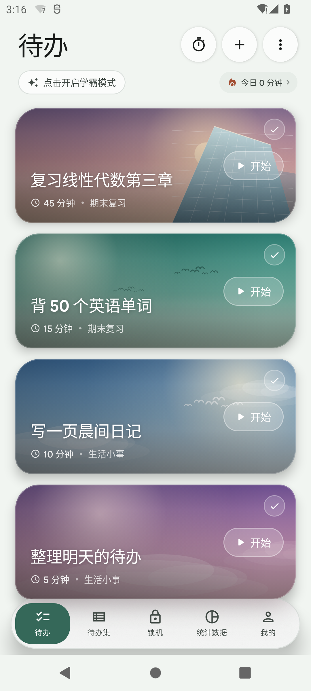
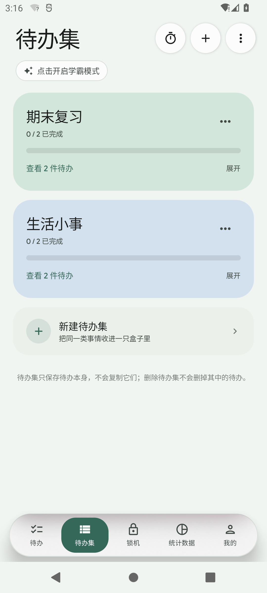
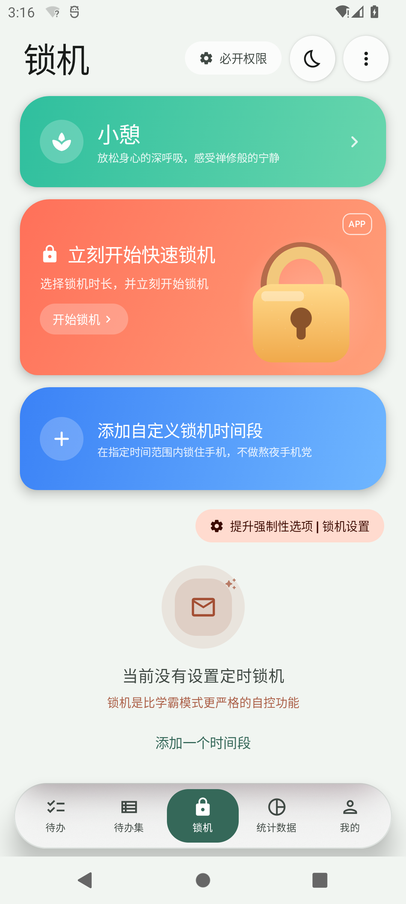
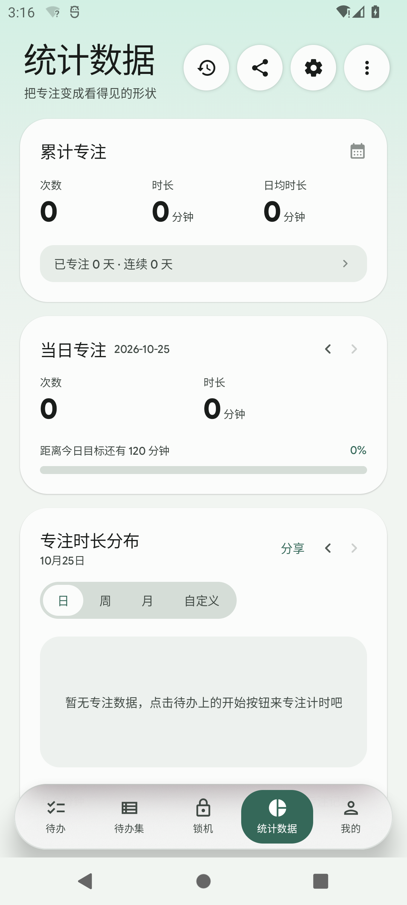
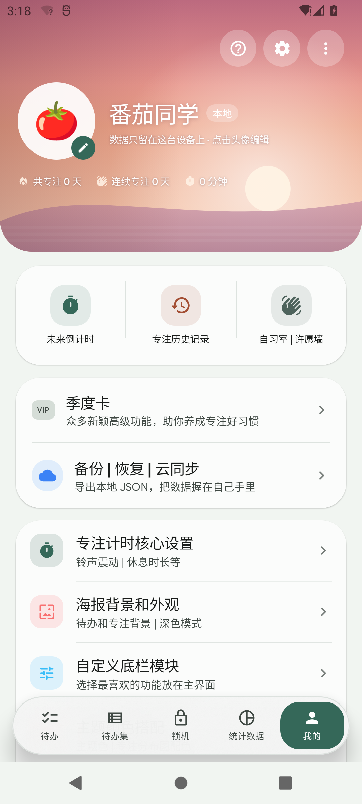
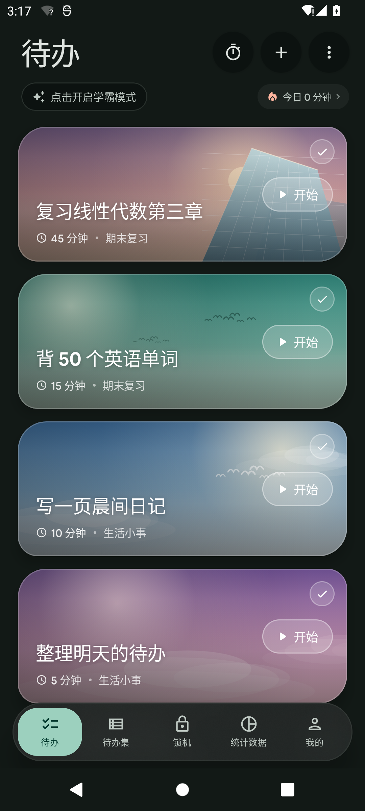
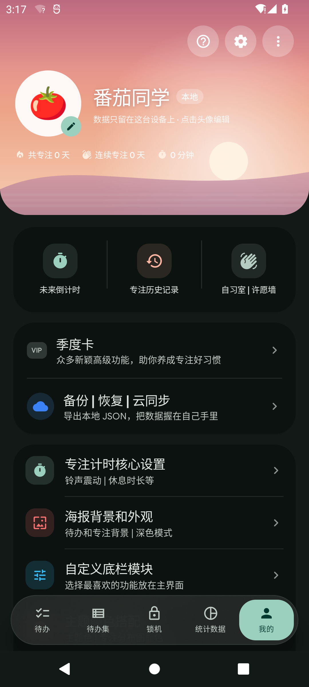

# TokiToDo

一个安静的自控工具：**待办 · 待办集 · 锁机 · 统计 · 我的**。

界面参考番茄 ToDo 的功能页结构，工程骨架与设计语言沿用 [TokiNote](../TokiNote/project)，
视觉全面按 **Material Design 3 Expressive** 重做：大圆角、非对称卡片、弹簧动效、
柔和纸色与插画封面。所有数据只保存在本机，**不申请网络权限**。

| 待办 | 待办集 | 锁机 |
| --- | --- | --- |
|  |  |  |

| 统计数据 | 我的 |
| --- | --- |
|  |  |

| 深色 · 待办 | 深色 · 我的 |
| --- | --- |
|  |  |

更多截图在 [`screenshots/`](screenshots)：专注计时、锁机进行中、待办编辑弹层、专注历史。

---

## 1. 能做什么

### 待办

- 插画封面卡：每件待办是一张实时绘制的 Canvas 海报（晴空 / 黄昏 / 薄荷 / 花霞 / 森林 / 极光 / 沙丘 / 莓夜）。
- 卡片左下是标题、时长和所属待办集，右侧是「开始」玻璃药丸，点一下进入全屏专注。
- 长按卡片编辑或删除；右上角圆圈勾选完成，已完成会沉到列表底部。
- 顶部：学霸模式开关、今日专注时长、快速专注（不绑定待办）、添加、更多菜单。
- 添加 / 编辑弹层：标题、时长胶囊、封面选择、待办集归属、备注、删除。

### 待办集

- 新建、重命名、换底色、删除；删除集子不会删除待办，只把它们变成未分类。
- 卡片进度条、完成数，展开查看集内待办并直接开始专注。
- 空状态、「什么是待办集」说明、新建入口。

### 锁机

- 小憩：5 / 10 / 15 / 20 分钟，全屏呼吸光晕。
- 快速锁机：15–90 分钟，全屏锁机页，**长按才能放弃**，可配置是否允许紧急解锁。
- 自定义锁机时间段：开始 / 结束时间（支持跨零点）、重复星期、启用开关、删除。
- 「提升强制性选项 | 锁机设置」：屏蔽通知、紧急解锁、显示倒计时、学霸模式。
- 权限说明：应用内锁机不需要权限；跨 App 强制才需要系统授权。

### 统计数据

- 累计：次数 / 时长 / 日均时长 / 专注天数 / 连续天数。
- 当日专注：日期前后切换、次数、时长、每日目标进度。
- 专注时长分布：日 / 周 / 月 / 自定义；柱状图点按查看具体区间；分享文本。
- 本月时段分布：凌晨 / 上午 / 下午 / 夜晚，找出最常专注的时段。
- 月度统计：本月累计 / 专注天数 / 日均 / 月历热力图 / 最长单次。
- 专注历史：按天分组、单条删除、全部清空。

### 我的

- 渐变日出 Hero、emoji 本地档案（昵称 + 头像）、共专注 / 连续专注 / 总时长。
- 快捷入口：未来倒计时、专注历史、自习室 · 许愿墙。
- 季度卡（本地完整版说明）、备份 | 恢复（导出 / 导入 JSON 文件）入口。
- 设置：专注计时核心设置、海报背景和外观、自定义底栏模块、主题颜色搭配、
  桌面小组件选项、连接电脑端专注助手、其他设置。
- 子页均可用：计时节奏与目标、深浅色 / 纯黑 / 减弱动效 / 动态取色、
  底栏文字标签与默认页、四套主色、小组件样式预览、配对码、导出 JSON、
  清空记录 / 清空全部数据、隐私说明。

## 2. 设计规范（M3 Expressive）

- **主色**：松针绿 `#356859`（种子），第三色柿子橙 `#A34E33` 负责锁机与提醒。
  四套预设：松针绿 / 柿子橙 / 海盐蓝 / 紫藤；支持系统动态取色与纯黑。
- **圆角**：8 / 14 / 20 / 28 / 38 dp；插画卡 `32·22·32·22`，锁机卡 `30·30·30·18`。
- **字体**：Google Sans Flex（可变字重），标题 Bold/SemiBold，数字用大号 display。
- **动效**：`TokiMotion` 统一弹簧参数；`Modifier.pressScale` 按压回弹；`LocalMotionEnabled`
  由「减弱动效」设置控制。
- **层级**：页面底 `surface` + 顶部 tonal 渐变光（统计页）；内容卡 `surfaceContainerLowest`；
  底部导航是单层毛玻璃胶囊（Haze 30dp + 高不透明度底 + 1dp 描边），
  真机有模糊，模拟器自动走可读的回退底色。
- **插画**：`Artwork.kt` 纯 Canvas 绘制，不下载图片、不需要存储权限；文字下方统一叠加暗角。

## 3. 工程结构

```
app/src/main/java/com/tokitodo/app/
├── MainActivity.kt                 # edge-to-edge、主题、状态栏图标
├── TokiToDoApplication.kt
├── data/
│   ├── Models.kt                   # Todo / 待办集 / 锁机时段 / 记录 / 愿望 / 倒计时
│   ├── AppSettings.kt              # 主题、计时、学霸模式、锁机、底栏、档案
│   ├── TokiStore.kt                # SharedPreferences + JSON，导出备份
│   ├── AppViewModel.kt             # 单一数据源，首次启动种子数据
│   ├── TimerViewModel.kt           # 专注 / 休息 / 小憩 / 锁机计时器 + 事件
│   └── Stats.kt                    # 纯函数统计：连续天数、日/周/月分布、时段
└── ui/
    ├── TokiToDoApp.kt              # 五个 Tab、二级页返回栈、计时覆盖层、完成弹窗
    ├── Dest.kt / Motion.kt / Format.kt
    ├── theme/                      # Color / Theme / Shape / Type / Glass
    ├── components/                 # Artwork、Common、NavBar、Charts、DetailScaffold
    ├── todos/                      # TodosScreen、TodoCard、TodoEditorSheet
    ├── collections/CollectionsScreen.kt
    ├── lock/LockScreen.kt
    ├── stats/StatsScreen.kt
    ├── profile/ProfileScreen.kt
    ├── settings/SettingsScreens.kt
    ├── extras/ExtrasScreens.kt     # 历史 / 倒计时 / 许愿墙 / 季度卡 / 学霸模式
    └── timer/TimerScreen.kt
```

## 4. 构建

```powershell
$env:JAVA_HOME = "D:\Application\Android Studio\jbr"
$env:ANDROID_HOME = "C:\Users\tokisaki\AppData\Local\Android\Sdk"
cd D:\DSH\TokiToDo
.\gradlew.bat assembleDebug

# 可选：R8 版本（未配置 KEYSTORE_FILE 时用 debug 签名）
.\gradlew.bat assembleRelease -x lintVitalAnalyzeRelease -x lintVitalRelease
```

产物：

- 可安装包：`dist/TokiToDo-0.1.0.apk`（release + R8，约 6.6 MB，debug 签名）
- 调试包：`app/build/outputs/apk/debug/app-debug.apk`
- `assembleRelease` 在未配置 `KEYSTORE_FILE` 时回退到 debug 签名，方便本地安装体验。

- Kotlin 2.4.21 / Compose 1.12.1 / Material3 1.5.0-beta02 / AGP 9.4.1 / Gradle 9.6
- minSdk 31，compileSdk / targetSdk 37，Java 17
- 首次构建需要联网拉取依赖元数据；之后 `--offline` 可复用缓存
- 依赖：`androidx.activity.compose`、`lifecycle`、`material-icons-extended`、Haze 2.0.1

## 5. 数据与隐私

- 无 `INTERNET` 权限，没有账号、统计上报、广告、云同步。
- 待办、待办集、锁机时段、专注记录、愿望、倒计时、设置全部在
  `shared_prefs/tokitodo_prefs.xml`。
- 「其他设置 → 备份」会把全部数据写成一份 JSON 文件；「导入备份」从文件恢复，
  覆盖当前的待办、待办集、锁机时段、记录、愿望和倒计时。云同步没有接入，也不会上传。

## 6. 验证情况

- API 31 模拟器（1080×2400，420dpi，3-button 导航）：安装、五个 Tab、编辑弹层、
  专注计时、锁机计时、长按放弃、统计图表、历史、外观设置、深浅色切换均已验证并截图。
- 可访问性节点检查：底栏五个入口、卡片开始 / 完成、顶部三个操作都暴露可点击语义。
- 已完成：定时锁机（每 20 秒检查时段并自动进入锁机页）、完成时提示音 / 震动、
  本地 JSON 备份与覆盖恢复。
- 尚未在真机验证：Haze 模糊观感、Pad 横屏；深色模式只在模拟器检查了一屏。
- 深色截图见 `screenshots/12–14`。
