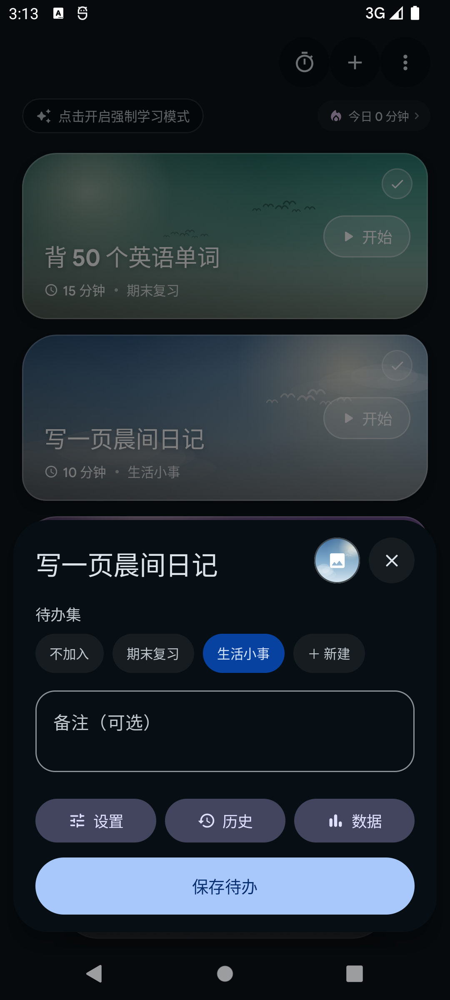
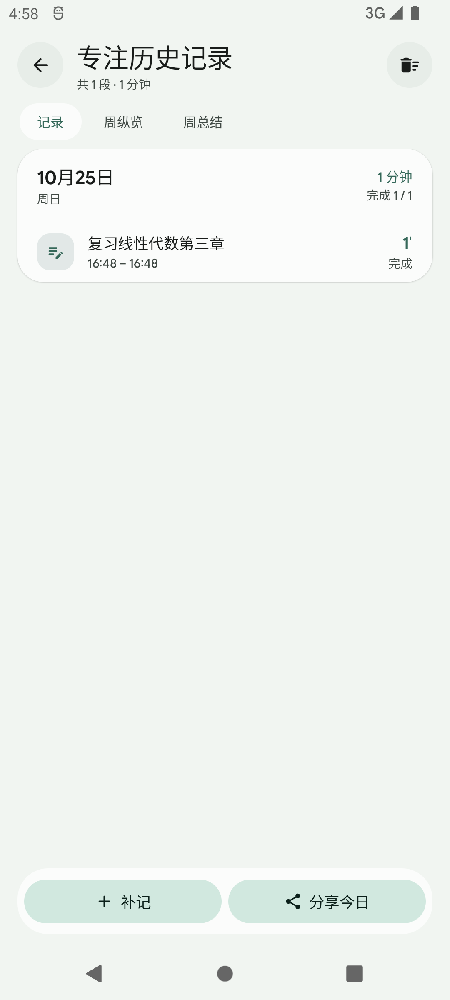
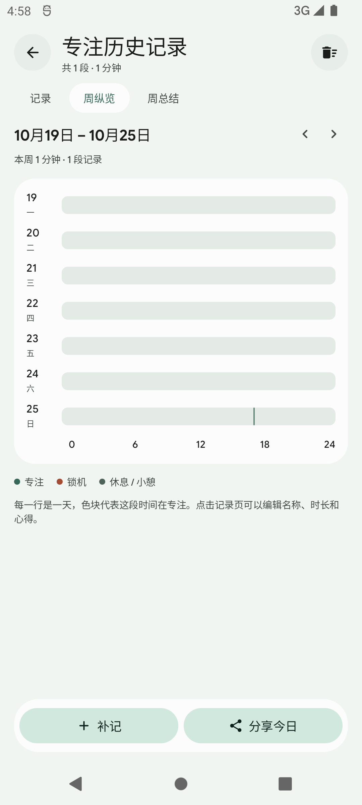
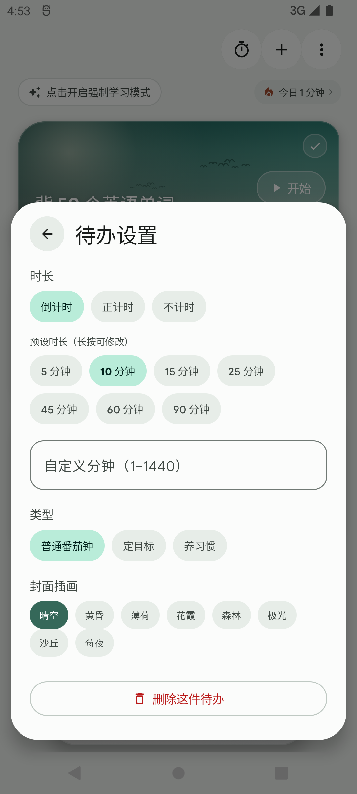

# TokiTodo

TokiTodo 是一个安静、本地优先的自控工具，包含**待办、待办集、锁机、统计、我的**五个页面。

界面按 [TokiUI](https://github.com/ichiyotsu/TokiNote) 的 One UI 页面规范重新排布：蓝粉渐变背景、34sp 大标题、24dp 页边距、26/28dp 卡片和紧凑设置列表；底栏保持 TokiNote 式悬浮胶囊。待办、专注记录和设置都保存在本机；只有检查软件更新时访问 GitHub，局域网 WebUI 需要手动开启。

## 截图

| 待办 | 待办集 |
| --- | --- |
|  |  |

| 我的 | 专注计时 |
| --- | --- |
|  |  |

| 待办编辑器 | 专注历史 |
| --- | --- |
|  |  |

| 周纵览 | 编辑器设置 |
| --- | --- |
|  |  |
